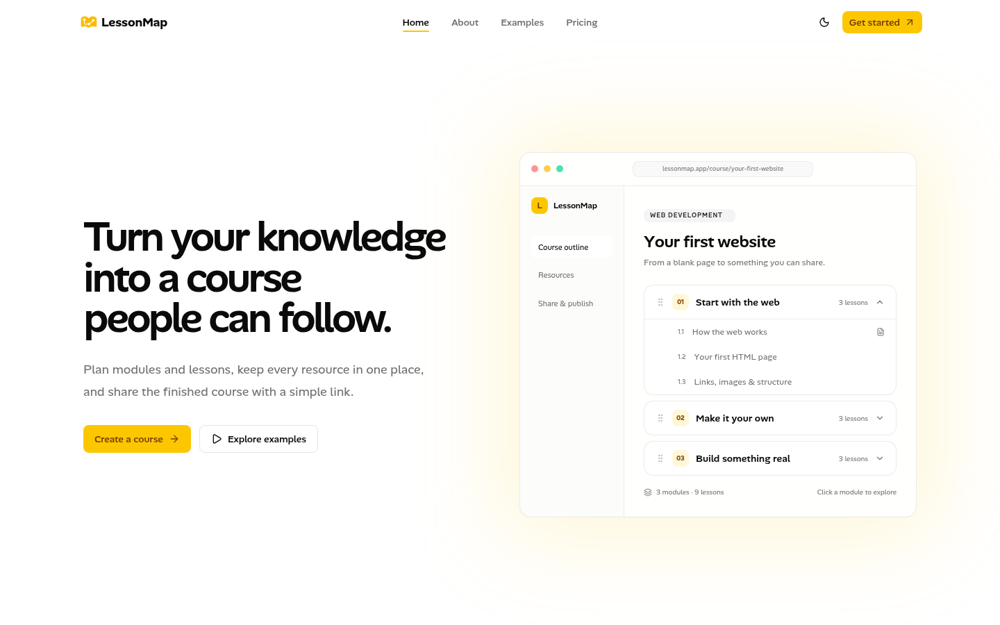
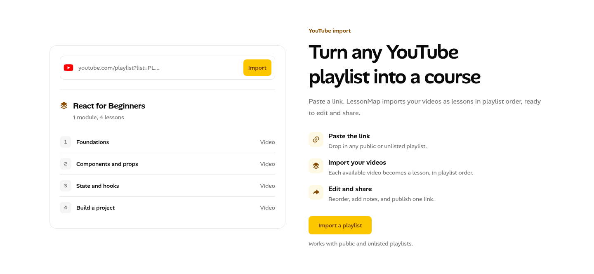
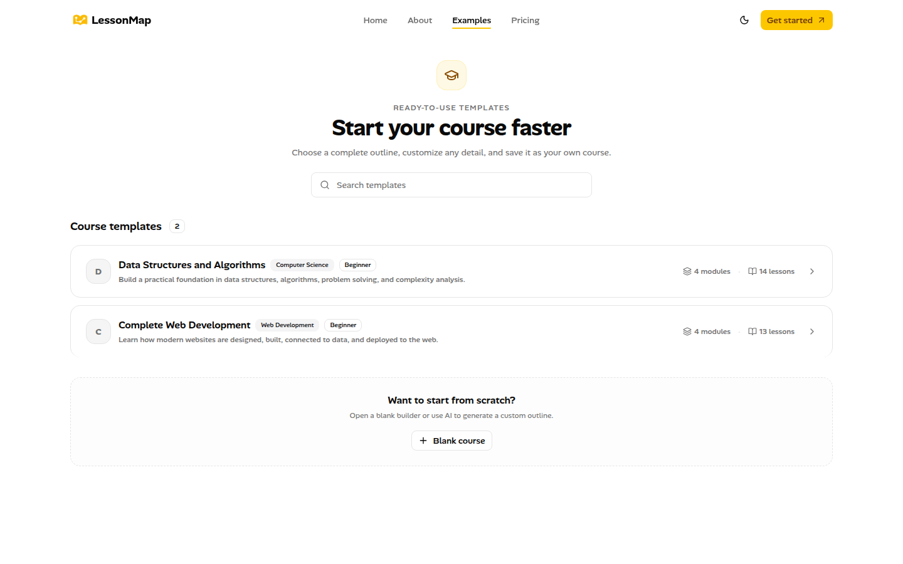
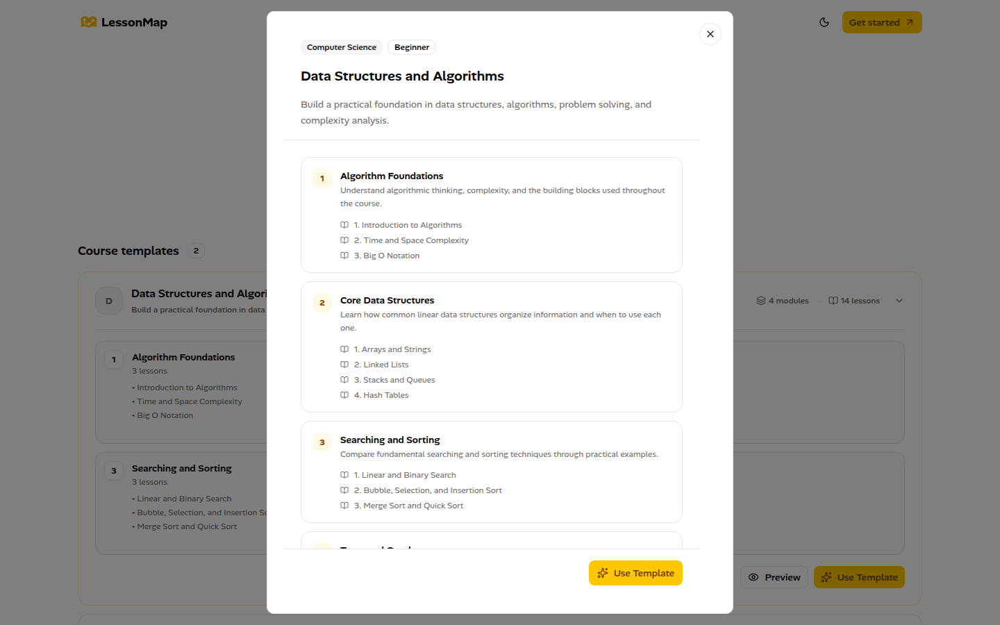

# LessonMap

### Turn your knowledge into a course people can follow.

LessonMap helps educators, creators, and trainers build structured courses and share them with learners. Start with an idea, a template, or a YouTube playlist. Shape it into modules and lessons, add your learning materials, and publish a course page from one workspace.

[Start creating](https://lessonmap.org/start) · [Explore templates](https://lessonmap.org/examples) · [View plans](https://lessonmap.org/pricing)

*Current landing page, including the illustrative course preview.*

## From idea to shared course

1. **Start your outline.** Build from scratch, choose a template, import a YouTube playlist, or describe your topic and audience to generate an AI draft.
2. **Shape the learning path.** Create modules, add lessons, and drag them into the order you want.
3. **Bring your materials together.** Add notes, links, code, documents, and images to the lessons where they belong.
4. **Publish and share.** Give learners a course link they can open and follow. Turn sharing off whenever you need to.

## Everything your course needs

| Feature | What you can do |
| --- | --- |
| **Course dashboard** | Keep your courses, lessons, and sharing status organized in one place. |
| **YouTube playlist import** | Import a public or unlisted playlist as an editable course draft, with each available video becoming a lesson in playlist order. |
| **Visual course builder** | Edit and reorder modules and lessons as your course takes shape. |
| **AI course outlines** | Turn a topic and audience into an editable starting point for your course. |
| **Starter templates** | Begin with a ready-made course structure and make it your own. |
| **Lesson resources** | Keep notes, links, code, PDFs, images, documents, and spreadsheets alongside each lesson. |
| **Resource previews** | Read supported materials and syntax-highlighted code without losing your lesson context. |
| **Public course pages** | Share your curriculum on a focused page with your name and course details. |
| **Learner progress** | Sign in to save completed lessons and keep track of your learning. |
| **Course exports** | Export your saved outlines as PDF or Markdown with a paid plan. |

## Turn a playlist into a course

Paste a public or unlisted YouTube playlist link to create a draft. Reorder the imported video lessons, add notes and resources, and share the finished course.

*The landing page’s YouTube import example: a playlist becomes an ordered set of video lessons.*

## Start with a template

Skip the blank page. Explore course templates, preview their lessons, and use one as the starting point for your own course. Adjust the structure and add materials to suit your audience.

*Preview a template’s curriculum before using it to create a course.*

## Give learners a clear path

Share a page that brings your course description, modules, lessons, and resources together. Learners can browse the curriculum and sign in to record their progress as they work through it.

## Built for the way you teach

- **Educators and trainers:** organize a curriculum and keep supporting materials with each lesson.
- **Independent creators:** turn your knowledge into a course you can share with your audience.
- **Bootcamp instructors:** give learners an ordered path through topics, exercises, and resources.
- **Self-directed learners:** build a study outline and track your progress through it.

[Create your first course](https://lessonmap.org/start) · [Find the right plan](https://lessonmap.org/pricing)

Screenshots are captured from the running local app and stored in [`docs/screenshots`](docs/screenshots). Landing page illustrations are labeled above; the template browser and preview are interactive application screens.

## Tech stack

Next.js · React · TypeScript · Tailwind CSS · shadcn/ui · Radix UI · PostgreSQL · Prisma · Better Auth · DeepSeek · Dodo Payments · Cloudflare R2 · Resend

---

Copyright © 2026 Ayush Khatri. All rights reserved.
